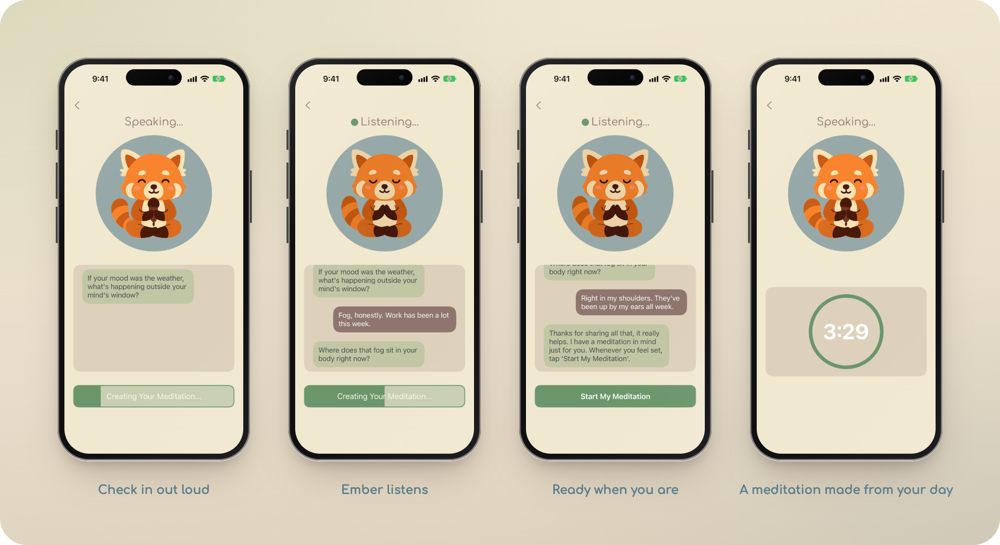
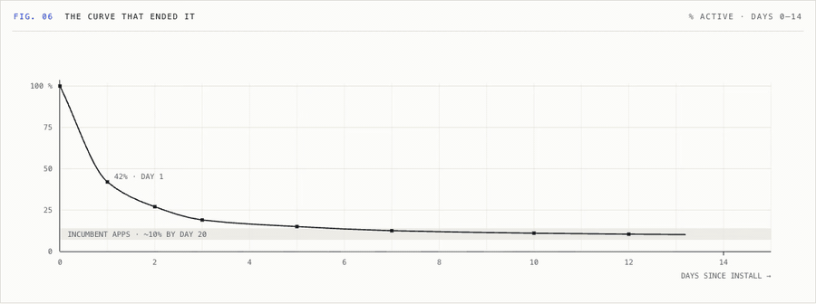
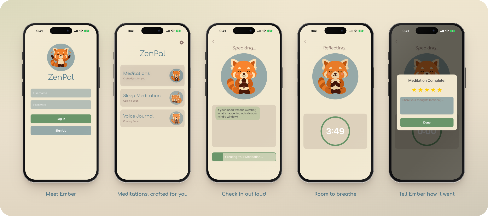
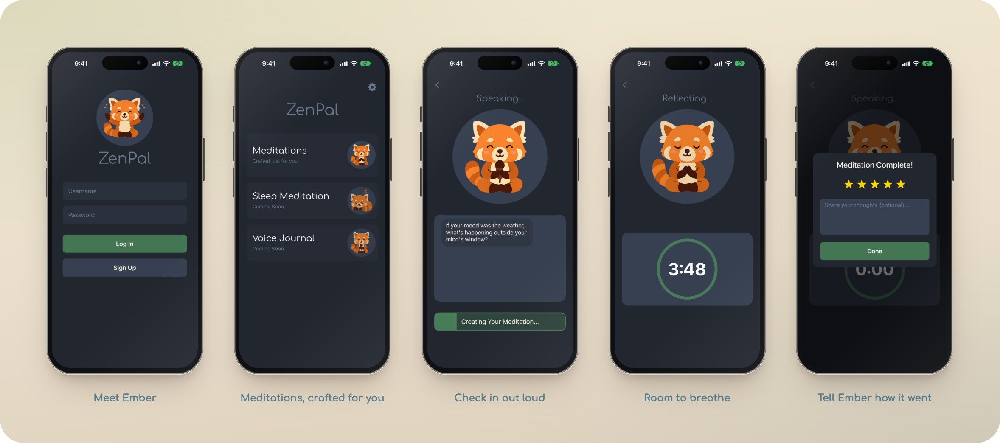
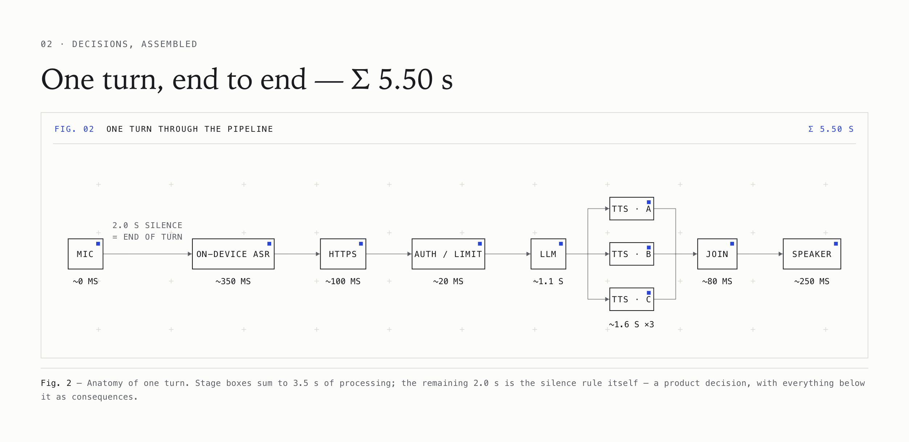
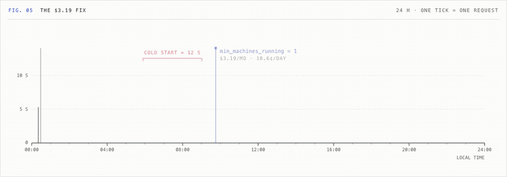

<p align="center">
  
</p>

<h1 align="center">ZenPal</h1>

<p align="center">
  <b>A voice-first AI meditation companion.</b><br>
  Tell Ember, a red panda guide, how you're feeling, and she builds a meditation around what you said.
</p>

<p align="center">
  Made by <a href="https://github.com/hassanjkhan">Hassan Khan</a> + <a href="https://abeyk.com">Abey Koolipurackal</a>
</p>

<p align="center">
  <a href="docs/ZenPal-Engineering-Report.pdf"><b>Engineering report (PDF)</b></a> ·
  <a href="https://abeyk.com/writing/talking-machines/"><b>Blog: Talking Machines</b></a>
</p>

<p align="center">
  
</p>

## Why we built it

One of us has meditated since childhood. The other went looking for help with stress and couldn't find an app that worked. We kept landing on the same gap: meditation apps are libraries of recordings, and a recording has no idea how your day went.

The people we interviewed said the same thing:

> "I'm having a panic attack and open Headspace to calm down, but I end up on a sleep meditation instead. I use it anyway because it's the best I could find at that moment."

Most people drift away: fewer than one in ten meditation-app users are still active three weeks in. A good teacher starts by asking how you're doing. We wanted to put that teacher in everyone's pocket.

## A session with Ember

You open the app and Ember asks how you are. You answer out loud, eyes closed if you like.

> **Ember:** If your mood was the weather, what's happening outside your mind's window?<br>
> **You:** Fog, honestly. Work has been a lot this week.<br>
> **Ember:** Where does that fog sit in your body right now?

After a few questions she builds a five-minute meditation from what you told her and guides you through it, slower, with long pauses. There's nothing to browse.

<p align="center">
  
</p>

## Product calls

**Voice first, because meditation forgives a pause.** In 2025 voice models had just become good enough for live conversation, but they were still slow and limited in emotional range. Therapy and companion apps need instant replies and a wide range of feeling. Meditation doesn't: a short pause before the guide speaks feels natural. We picked the use case that suited where the technology was.

**Hands-free, eyes closed.** Push-to-talk would break the experience, and echo cancellation kept picking up Ember's own voice. So the mic and speaker are never open at the same time, two seconds of silence ends your turn, and a tap interrupts her.

**Ember has a personality.** She's a red panda: calm, warm and a little playful. Her prompt runs in three phases (interview, hand-off to the Start My Meditation button, meditation), and each phase has its own voice direction: quick and warm while chatting, slow and spacious while guiding.

**Know what a session costs before growing.** A session costs about 7¢, almost all of it voice. That set the scaling plan: cache the intros and outros every session shares, and pre-generate scheduled meditations at batch prices, which together cut the cost by more than half.

**Let usage make the call.** We shipped to TestFlight, interviewed 20 people and ran 150+ beta sessions. Day-14 retention came in around 10%, level with the established apps. Then Headspace launched its own AI companion. Pulling ahead would have meant months more on memory and habit loops, so we wound ZenPal down and took the lessons with us.

<p align="center">
  
</p>

## Design

<p align="center">
  
  
</p>

The whole screen belongs to Ember. She greets you happy, settles into a meditating pose while she listens and thinks, and switches to talking when she answers, with a soft cross-fade and a small label for each state. The app follows light and dark mode, and the only controls are a progress bar that turns into the Start My Meditation button, a five-minute timer during the meditation, and a tap to interrupt.

## Engineering

The voice AI stack was changing month to month, so we didn't try to pick winners on paper. We built the alternatives, measured them on real sessions, and kept what won. The [engineering report](docs/ZenPal-Engineering-Report.pdf) walks through every decision.

| | Tried | Shipped | Why |
|---|---|---|---|
| **Transport** | Realtime voice-to-voice | REST + async fan-out | Realtime gave ~1 s turns at ~10× the cost on brand-new APIs |
| **Speech-to-text** | Whisper on the server | Apple on-device | Instant, free, and audio never leaves the phone |
| **LLM** | `gpt-4o` | `gpt-4o-mini` | Same quality for two-sentence replies at a fraction of the price |
| **Text-to-speech** | `tts-1-hd`, `tts-1` | `gpt-4o-mini-tts` | Fast, and its tone can be directed per request |
| **Cold starts** | Cron pinger, Redis warm state | One always-on machine | Ended the morning wait for $3.19/month |

### The iOS app

Hassan led the iOS app: everything you see and hear during a session.

- **A session that runs itself.** `ConversationManager` moves each session from check-in to meditation and back, and through Ember's states in every turn: listening, thinking, talking. It owns the timing, so the mic and speaker never overlap and the conversation needs no buttons.
- **Knowing when you've finished talking.** `SpeechManager` watches on-device recognition and ends your turn after two seconds of silence, which is what makes the app hands-free.
- **Ember on screen.** `RedPandaView` cross-fades her between poses as the conversation state changes, in light and dark mode.
- **Progress you can see.** A progress bar fills as you talk with Ember and turns into the Start My Meditation button when she's ready. During the meditation a five-minute timer counts down. A tap interrupts Ember, the screen stays awake while you're eyes-closed, and a short feedback screen at the end saves how each session felt to Firestore.
- **Accounts.** Sign-up and login with Firebase Auth.

### The voice backend: making the wait feel natural

Abey led the backend and the voice pipeline. In a voice app, a long silence feels like the app froze. Chaining speech-to-text, the LLM and text-to-speech one after another took 10.7 seconds per turn, and we got it to 5.5.

<p align="center">
  
</p>

- **Timers on every step.** Every `await` in the backend logs its elapsed time, so each turn reports where its time went. The model calls dominated, so that's where the work went.
- **Speech recognition on the phone.** Only text goes to the server.
- **Nothing extra in the way.** Saving the transcript runs alongside the reply instead of before it.
- **Parallel voice.** Ember's reply is split into chunks, voiced at the same time and joined back together ([`tts_parallel_stitch`](Backend/app/services/openai_service.py)), which took synthesis from 4.5 s to 1.6 s.

<p align="center">
  
</p>

Testers then told us a meditation's mood sometimes shifted halfway through, because each chunk picks its own tone. So conversation uses the fast parallel path, and meditations are voiced in one continuous take.

### Prompts as production code

Ember's personality changed almost daily while testers already had the app. The backend accepts older message formats and only ever adds fields, so prompt updates went out like any other deploy and never broke a session in progress.

### Problems we chased down

- **The first user each morning waited 12 seconds.** The single server shut down overnight to save money. A cron pinger and a Redis warm-state experiment didn't fix it. Logs showed the spikes were machine starts rather than vendor latency, and keeping one machine running solved it for $3.19/month.
- **Every user got the same "random" opener.** Ember's first question was chosen once when the server process started. While machines restarted often, it looked random. Once the server stayed up, it stopped changing, until a tester noticed. ([fix](Backend/app/routers/chat.py))
- **The app heard "Ember" as "amber".** Fixed with custom vocabulary hints and a word-boundary pass over the transcript. ([fix](SageiOS/Sage/Sage/SpeechManagement/SpeechRecognizer.swift))

<p align="center">
  
</p>

### How it fits together

<p align="center">
  
</p>

The iOS app sends the conversation so far and how far into the session you are. The backend answers with the right phase: interview at the start, closing at the end. It keeps no session state, so any machine can serve any request and a deploy never drops a session.

**Stack:** Swift / UIKit · Python / FastAPI · OpenAI `gpt-4o-mini` and `gpt-4o-mini-tts` · Apple on-device speech recognition · Firebase Auth and Firestore · Fly.io

### Where we'd take it next

Realtime voice-to-voice models have matured since we built ZenPal. They'd take over turn-taking, interruptions and voicing in one model, bringing a turn close to a second. What would stay ours: who you are, what Ember should remember about you, the shape of a session, safety, and what each session costs.

## Repo map

```
Backend/              FastAPI service
  app/routers/          chat.py · meditation_router.py   (endpoints and Ember's prompts)
  app/services/         openai_service.py                (LLM and voice, incl. tts_parallel_stitch)
                        rate_limiter.py · firebase_client.py
  fly.toml              one always-on 512 MB machine
SageiOS/Sage/Sage/    iOS app (Swift / UIKit)
  ConversationManager/  session phases, turn timing
  SpeechManagement/     on-device speech recognition, end-of-turn detection
  RedPandaView/         Ember and her poses
SageWeb/              landing page
docs/                 engineering report (PDF and HTML), figures, screenshots
```

## Running the backend

```bash
cd Backend
python3 -m venv venv && source venv/bin/activate
pip install -r requirements.txt
printf 'OPENAI_API_KEY=sk-...\n' > .env      # optional: boots without it; /chat and /meditate return 503
uvicorn main:app --reload --port 8000
```

API docs at http://localhost:8000/docs. `/health` works without any credentials.

---

<p align="center">
  Built in 2025 by <a href="https://github.com/hassanjkhan">Hassan Khan</a> (iOS) and <a href="https://abeyk.com">Abey Koolipurackal</a> (backend and voice).<br>
  <sub>ZenPal's working name was Sage, which is why the code folders are named Sage.</sub>
</p>
