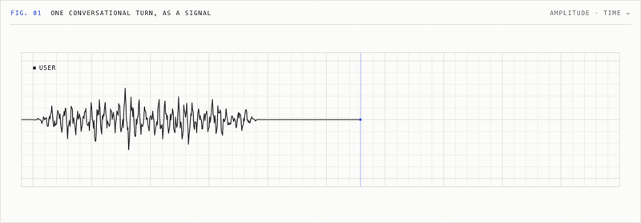
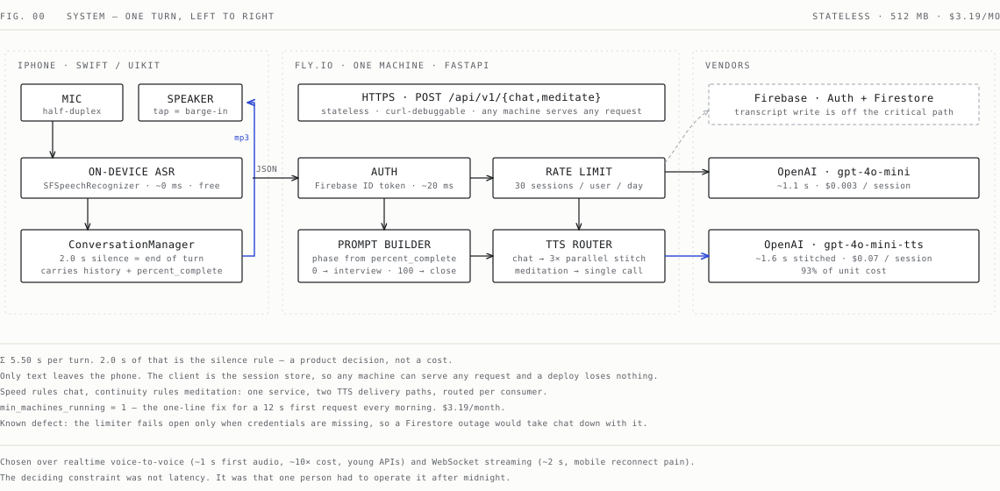
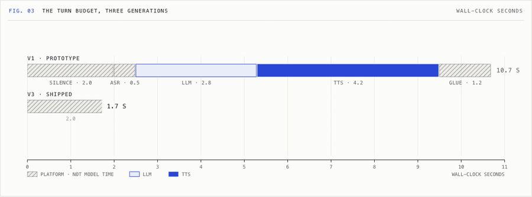
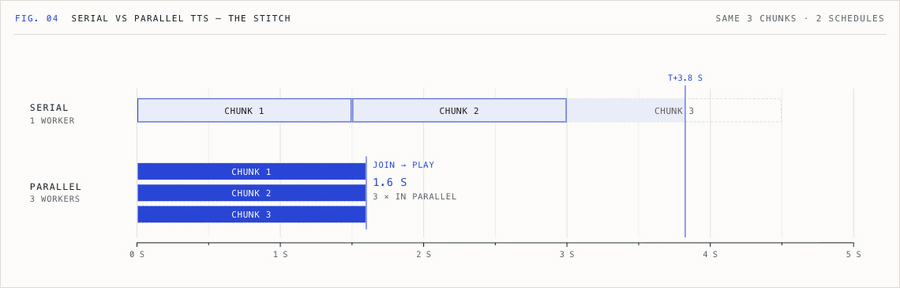

# Sage AI — a voice meditation app, and the hypothesis it was built to test

**A meditation generated from a conversation you just had should hold people better than a library of recordings. It didn't. This repo is the test, and the shutdown is part of the result.**

Two of us built this nights and weekends around day jobs at Instagram, April 28 – June 2 2025: 249 commits, an iOS app, a FastAPI backend on one 512 MB machine, 150+ beta tests, and a decision to stop that came from a retention curve rather than from losing interest.

I owned the backend, the latency work, and the prompt and voice pipeline (84 of 85 backend commits). The iOS client was shared with [@hassanjkhan](https://github.com/hassanjkhan).

- **[Read the engineering field report →](docs/field-report/index.html)** — 30 slides, the long version: every decision with the alternatives that lost, the four bugs, the unit economics. Open it in a browser.
- **[Backend](Backend/)** · **[iOS client](SageiOS/)** · **[Marketing site](SageWeb/)**

---

## 1. The hypothesis

Meditation apps ship static, pre-recorded sessions. They can't be matched to the mood you actually walked in with, and the engagement data shows it — **fewer than 10% of users are still active by day 20**, an industry-wide number, and one that showed up in our own user interviews as a specific failure:

> "I'm having a panic attack and open Headspace to calm down, but I end up on a sleep meditation instead. I use it anyway because it's the best I could find at that moment."
>
> — one of 20 user interviews

So the bet, stated so it can lose:

> **If the meditation is generated from a conversation you just had — and the guide remembers you across sessions — then day-N retention should beat the static-library incumbents by enough to justify the cost of generating audio per user.**

Two things had to be true for that to be worth testing in 2025, and both had just become true: voice models had gotten good enough for live interaction, and meditation is unusually forgiving as a first voice use case — **latency is tolerable and you don't need highly expressive emotional range**, unlike therapy or companionship apps. A pause in a meditation is a feature. That is the whole reason this was the product and not a therapy bot.

**The product:** you talk to Ember, a red panda guide. She interviews you for a few turns, then generates a five-minute meditation built from what you actually said.

<p align="center">
  
</p>

## 2. What the answer turned out to be

<p align="center">
  
</p>

**Day-14 retention landed at ~10% of the beta cohort — parity with the incumbents, not a win.** The cohort is small, so the honest reading is a parity *band*, not a point estimate. But parity was the problem: parity meant months more work on memory and habit loops just to keep testing the thesis, and midway through, Headspace shipped its own AI companion. The differentiation argument was gone.

We stopped. The number was the reason.

The stronger version of this ending is an experiment I didn't run — one variable (does the app open by recalling your last session?), two cohorts, and a decision gate written down *before* the readout. That design is in [the field report's appendix](docs/field-report/index.html), marked as extrapolated. It's the thing I'd do first next time: the project ended on one number when it deserved a controlled one.

## 3. How it works

<p align="center">
  
</p>

Two endpoints, both stateless:

| | `POST /api/v1/chat` | `POST /api/v1/meditate` |
|---|---|---|
| **Job** | interview the user | generate the next meditation phrase |
| **Model** | `gpt-4o-mini` | `gpt-4o-mini` |
| **TTS** | 3-way parallel stitch, ~1.6 s | single call, ~4.5 s |
| **Optimised for** | speed | prosody continuity |

The client sends the full conversation plus `percent_complete` on every request, and the server returns the matching phase — interview at 0, closing at 100. **No server-side session state at all**: any machine can serve any request, a deploy loses nothing, and there is no Redis to operate. The price is that a client can lie about its progress, which is bounded by auth and the 30-sessions/day cap, and that resending full history grows tokens per turn, which is bounded by session length. Before money changed hands that trade would flip to server-issued session tokens.

## 4. The engineering: recovering 5.2 seconds

A chat app hides a slow model behind a typing indicator. **In audio, silence reads as a crash.** The naive chain — speech-to-text → LLM → text-to-speech, run one after another — took 10.7 seconds per turn.

<p align="center">
  
</p>

The commit that started this is [`perf(backend): drop to gpt-4o-mini and log elapsed time at every await`](Backend/app/services/openai_service.py) — 4:07 AM, and the important half is the second clause. It put a timer in front of every stage, and from then on every turn reported what each stage cost. No APM vendor: when every slow part is a network call, wall-clock deltas are enough.

```
[0.000s] chat processing start
[0.048s] auth ok
[1.310s] LLM reply received
[TTS]    3 chunks · gather wall 1.62s
[FS]     audit write (concurrent)
[3.05s]  total server time
```

The logs made the argument simple: model calls dominate, everything else is noise, and anything optimised without a timer in front of it is decoration.

**Where the time went.** Speech recognition moved on-device (Apple's `SFSpeechRecognizer`) — instant, free, and only text ever leaves the phone. The transcript write moved off the critical path with `asyncio.gather`. And TTS got split into chunks synthesised in parallel and byte-concatenated:

<p align="center">
  
</p>

Wall time collapses from the sum of the chunks to the slowest one. MP3 frames carry their own sync headers, so decoders forgive the seams — you can concatenate the bytes and play the result. That is [`tts_parallel_stitch`](Backend/app/services/openai_service.py).

**What that cost.** Each TTS request renders emotional tone from scratch, so chunk two came back in a different mood than chunk one — and the chunk boundaries kept landing exactly on the scripted pauses. Testers reported the voice changing mood mid-meditation. The benchmark measured seconds; the users were hearing mood. **The fix was routing, not code**: chat keeps the stitch, meditation gets one unbroken call. Both paths ship, chosen per consumer.

## 5. Four bugs worth keeping

**The always-on fix froze the randomness.** Ember's opening question was chosen with `random.choice` at module scope. Under scale-to-zero this was invisible — every cold start re-rolled it, so the bug behaved like the feature. Once the machine stayed up for days, one process meant one roll, and every user got the identical "random" opener until a beta tester noticed. Two changes, each correct alone, composed into a user-visible bug. **Process lifetime is part of the program's semantics.** ([fix](Backend/app/routers/chat.py))

**The first user each morning waited 12 seconds.**

<p align="center">
  
</p>

Scale-to-zero stopped the only machine when idle, so the first turn of the day paid boot plus imports plus client init before saying a word. A cron pinger turned warmth into a coin flip against the idle timer. A Redis warm-state spike solved the wrong half of a problem that was mostly process start. The fix was `min_machines_running = 0 → 1` — one line, $3.19/month, and one evening of evidence to prove the outliers were machine starts and not vendor latency.

**It heard "Ember" as "amber" for weeks.** On-device recognition is free and instant, and the price is that its vocabulary is not yours. Fixed with `contextualStrings` plus a word-boundary pass over the final transcript. ([fix](SageiOS/Sage/Sage/SpeechManagement/SpeechRecognizer.swift))

**The app answered its own voice, indefinitely.** Echo cancellation is probabilistic and leaks meditation words into transcripts; push-to-talk kills the eyes-closed promise. Shipped instead as a **half-duplex invariant** — mic and speaker never open together, interruption is a tap. Deterministic, and debuggable with print statements.

**And one found while writing this up:** the rate limiter fails open only when its *credentials* are missing. If Firestore itself went down, `doc_ref.get()` would raise and chat would go down with it — availability accidentally coupled to a non-critical dependency. Wrong default, one-line fix. It's still in [`rate_limiter.py`](Backend/app/services/rate_limiter.py) as written; the field report runs the full incident it was waiting to cause.

## 6. What it cost

**A session costs 7¢, and the voice is 93% of it** — $0.07 TTS against $0.003 for the language model. The LLM is a rounding error, which inverts the usual intuition about where genAI spend goes.

At 10k daily sessions that's ~$21k/month naive. The levers compound rather than add: caching shared intros and outros (~30% of spoken time) × the vendors' half-price batch tier for pre-generated scheduled meditations ≈ $8k. Shipping Opus behind signed URLs instead of base64-inflated JSON halves the bytes on the wire.

Worth naming: **the vendors break before my code does.** TTS rate limits bite at 50–100 concurrent; the single machine isn't the constraint until ~200. The $3.19 machine is third on its own failure list.

## 7. What a 2026 rebuild deletes

Realtime voice-to-voice APIs absorb turn-taking, barge-in, and speech in both directions into one model. The endpointing rule, the parallel stitch, the prosody seams, and the echo loop **stop existing as categories** — two of the four bugs above and the entire latency chapter go with them.

What doesn't move: identity, spend caps, phase state, memory, safety hooks, cost metering. Vendors sell the voice; nobody sells knowing that a meditation must end at a button, or how much a given user is allowed to cost you today. And that problem grows — realtime pricing makes 93%-on-TTS look cheap.

The transferable part isn't the stack. It's that everything here was built twice and measured before one was deleted: realtime *and* REST, Whisper *and* on-device, `gpt-4o` *and* `gpt-4o-mini`, serial *and* parallel TTS. AI-assisted prototyping made building both sides nearly free, which moves the engineering judgment to **choosing what to delete**.

## 8. Repo map

```
Backend/          FastAPI service — the part I'd show first
  app/routers/      chat.py · meditation_router.py   (endpoints + the prompts, which are production code)
  app/services/     openai_service.py                (LLM + TTS, incl. tts_parallel_stitch)
                    rate_limiter.py · firebase_client.py
  fly.toml          512 MB, one always-on machine
SageiOS/Sage/     iOS client (Swift/UIKit)
  ConversationManager/   phase state machine, turn timing
  SpeechManagement/      on-device ASR + the 2.0 s silence rule
SageWeb/          marketing site
docs/field-report/     the 30-slide engineering writeup
docs/figures/          the figures above
```

## 9. Running the backend

```bash
cd Backend
python3 -m venv venv && source venv/bin/activate
pip install -r requirements.txt
printf 'OPENAI_API_KEY=sk-...\n' > .env      # optional: boots without it, /chat and /meditate will 503
uvicorn main:app --reload --port 8000
```

Interactive API docs at http://localhost:8000/docs — `/health` responds without any credentials configured.

## 10. A note on the commit history

The messages in this log are not the ones I typed at 3 AM. The originals were `prompts`, `tts`, `idk`, and — eight times in one night — `prompts` again. They've been rewritten to say what each commit actually changed, with the diffs re-read one by one; authorship, timestamps and file contents are untouched.

Two were not just vague but wrong, which is the argument for doing it: `get rid of rate limits` actually *added* an admin whitelist, and `design assets` actually changed the speech end-of-turn timer. The original log is preserved verbatim in [the field report](docs/field-report/index.html), where the 1:24 AM → 5:32 AM run is reproduced in full — including the moment the message quality collapses at 3:06.

---

*Built as Sage AI, shipped to TestFlight as ZenPal. The guide is Ember.*
